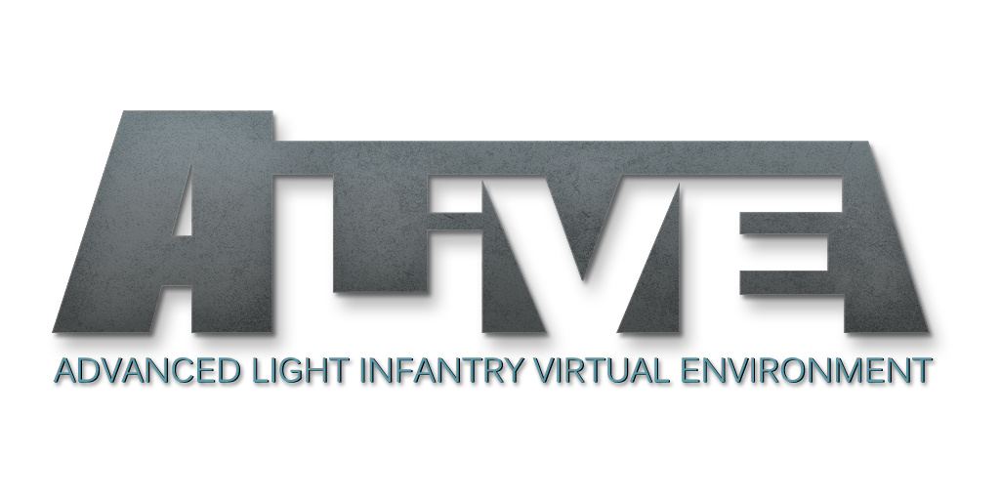

    

    
    
    
    
    
    

    <strong>Requires the latest version of <a href="https://github.com/CBATeam/CBA_A3/releases">CBA A3</a>.</strong>

Built by Arma community veterans, the **Advanced Light Infantry Virtual Environment (ALiVE)** is an easy to use modular mission framework for Arma 3. Its editor modules give players and mission makers everything they need to run realistic military operations up to company level, almost anywhere: command, combat support, service support and logistics.

### Main Features

- **Virtual Profile System:** thousands of units operate across the map with little effect on performance. Virtual groups keep moving, fighting and holding ground, and spawn into the world when players come near.
- **AI Commanders:** a layered Operational Command reads the battlefield, weighs friendly and enemy strength, and sends forces after key objectives, so the fight changes as it goes.
- **Terrain indexes:** ALiVE ships with indexes of military, civilian and industrial sites for more than 170 terrains, and the Map Indexer can make one for any other.
- **Persistence:** campaigns are saved on the server itself, with no database to install. Units, objectives, logistics and markers come back where they were left.
- **Player Support:** Combat Support, Combat Service Support and C2ISTAR radio menus, plus Respawn, View Distance and Advanced Markers.

### Tools on alivemod.com

- **[War Room](https://www.alivemod.com/warroom/):** your group's servers, a live map of running operations, replays, Server Health, and orders for AI groups.
- **[Mission Builder](https://www.alivemod.com/alive3/mission_builder.htm):** plan a mission on the map and export it for Eden.
- **[Server Browser](https://www.alivemod.com/warroom/):** find an ALiVE server and join it.
- **[Terrain Indexer](https://www.alivemod.com/alive3/sys_indexer.htm):** index a terrain so ALiVE knows its places, then [submit it](https://www.alivemod.com/alive3/submit_terrain.htm) for everyone.
- **[Documentation](https://www.alivemod.com/alive3/):** how every part of ALiVE works, with an [FAQ](https://www.alivemod.com/alive3/faq.htm), in 7 languages.

### Installation

- **Players:** subscribe to ALiVE and CBA_A3 on the Steam Workshop and load both in the Arma 3 Launcher. For a manual install, use `-mod=@CBA_A3;@ALiVE`.
- **Dedicated servers:** use `-mod=@CBA_A3;@ALiVE`. To report to the War Room, also load the War Room server mod with `-serverMod=@alive_wr` (see the [War Room docs](https://www.alivemod.com/alive3/warroom_servers.htm)).
- **Dev build:** the latest fixes go out first on the [ALiVE Development Version](https://steamcommunity.com/sharedfiles/filedetails/?id=2791077612) Workshop item. Use it to test a fix before the next release.
- Check [mod conflicts](https://www.alivemod.com/alive3/mod_conflicts.htm) if something behaves oddly alongside other mods.

#### Content for other mods and CDLC
ALiVE ships support for some mods and Creator DLC in its `addons` folder. Each part loads only when the mod it needs is loaded too, and is skipped quietly otherwise, so there is nothing to copy in or out:

| Addon | Loads when this is loaded | Adds |
|---|---|---|
| `composition_vn` | S.O.G. Prairie Fire | Jungle military compositions for camps, field HQs and outposts |
| `composition_spe` | Spearhead 1944 | Bocage military and guerrilla compositions |
| `composition_cup` | CUP Terrains Core | Desert, Woodland and Pacific compositions built from CUP objects |
| `compatibility_gm` | Global Mobilization | ALiVE factions and groups for Global Mobilization units |
| `compatibility_wbk` | WebKnight's Zombies and Creatures | Zombie groups for its WBK Zombies faction, so Military Placement and the AI Commander can field it |

Without the mod, the server log shows a line like `Skipped loading of addon 'ALiVE_composition_vn' as required addon 'loadorder_f_vietnam' is not present`. That is expected and not an error.

These four used to live in the `optional` folder and had to be copied into `addons` by hand. In `@ALiVE` the update replaces those copies, since the files have the same names. If you copied any of them into another mod folder, delete them there, or the old ungated copy loads alongside the new one.

#### Optional addons
The `optional` folder now holds only server-side choices that change behaviour, so they stay opt-in. Copy one into `@ALiVE\addons` on the dedicated server to use it:

- `sys_data_auto` adds the Data module on a dedicated server for missions that don't place one
- `sys_data_auto_perfmon` does the same with player statistics off and performance monitoring on

### Help
There are several entries in the Field Manual which will guide you through interacting with key in game ALiVE features.

- By default, ALiVE uses the **App Key** to open the ALiVE interaction menu.  The app key is found next to your right control key. If you do not have an app key or wish to use a different binding, you can remap it in the mods keybinding menu once in game. 
- Some features will require that you carry a **Laser Designator** (or any custom item defined in the editor modules).
- For Advanced Markers, access the map and press **CTRL ALT LMB** to place or edit a marker. Press **CTRL ALT RMB** to delete a marker.

For full instructions see the documentation at https://www.alivemod.com/alive3/

Join us on Discord: https://discord.gg/KkacXFx

### Contributing

ALiVE is going through a module by module overhaul. If you are reporting a bug, requesting a feature or thinking about a pull request, please read [CONTRIBUTING.md](CONTRIBUTING.md) first. A bug report with an RPT log attached is the fastest route to a fix.

### How It Works
ALiVE is complex but not complicated. Each module is standalone but they can be synchronised to each other to create different scenarios. The modules work independently but will use data derived from another module if it is synchronised. This layered approach provides a high degree of flexibility and allows you to build custom scenarios quickly.

Everything starts with the Placement modules. These modules fulfill two important functions: they identify a list of military and civilian objectives or areas of importance across the map and secondly, they place the AI groups. There are several module parameters for customising the type of objectives and also the shape and size of the AI forces. Refer to the Military and Civilian Placement Module pages for further details on these.

The objectives come from a terrain index: a survey of the map's buildings, roads and open ground that ships with ALiVE for more than 170 terrains. On a terrain without one, placement and the AI Commanders have little to work from, and the startup screen says so. The Map Indexer module can make an index for any terrain, and indexes made by the community are added to ALiVE.

If an AI Commander is placed, it will take command of all available AI forces of its faction. However, it needs to know where its objectives are and this is simply done by synchronising it to one or more Placements Modules.  So for example you could place an OPFOR Military Placement module to occupy an area of the map then sync a BLUFOR AI Commander to it so it knows to attack those objectives.

Using different combinations of modules it is possible to quickly create a huge range of scenarios, from massive tank battles to intense urban counter insurgency. The best way is to experiment!

### Licence

ALiVE is free to play, but it is not open source. All rights belong to the ALiVE Mod Team.

- You may use ALiVE to play, host servers and make missions, and share missions that list ALiVE as a required mod.
- You may not re-upload ALiVE (including builds made from this repository), port or repackage any part of it into other mods, or make money from it, without the team's written permission.
- Pull requests, terrain indexes and other contributions pass to the ALiVE Mod Team, and contributors are credited.

Full terms: [LICENSE.txt](LICENSE.txt).
